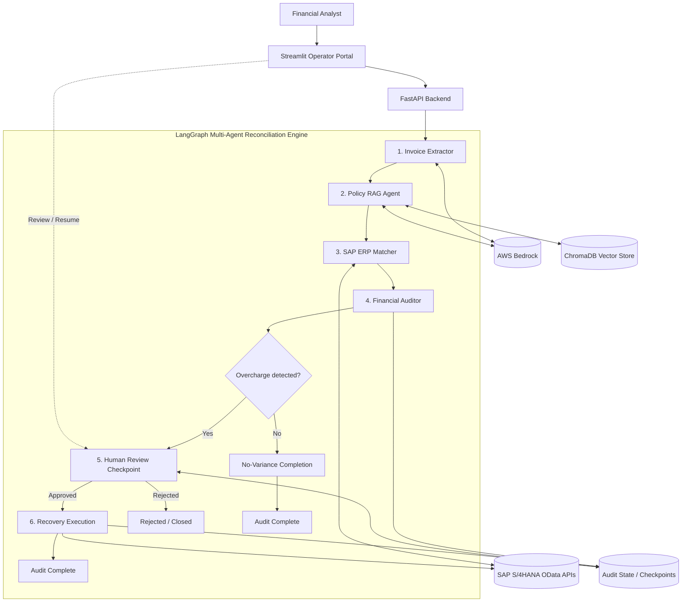
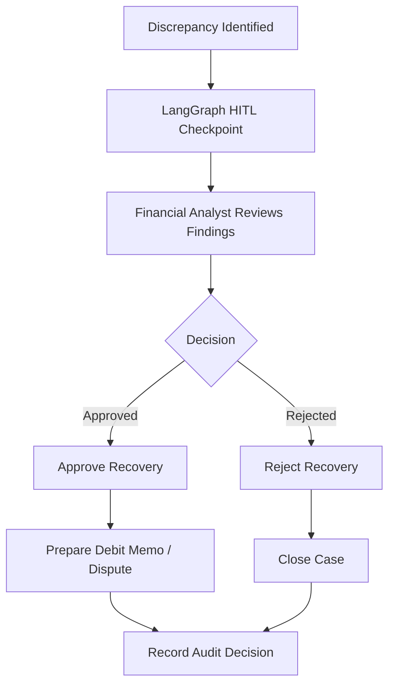

# ⚖️ RevRecover AI — Enterprise Revenue Recovery Platform


**RevRecover AI** is an AI-powered, agentic Accounts Payable (AP) audit and revenue recovery platform designed to identify supplier billing discrepancies through automated three-way reconciliation.

The platform compares:

1. **Supplier Invoices** — Billed quantities, unit prices, and totals.
2. **SAP S/4HANA Purchase Orders** — Approved quantities and agreed pricing.
3. **Vendor Contracts (MSAs/SLAs)** — Contractual rate caps, rebates, discounts, and service-level agreements.

By combining **LangGraph, AWS Bedrock, Retrieval-Augmented Generation (RAG), SAP ERP integration, and Human-in-the-Loop (HITL) workflows**, RevRecover AI aims to automate financial discrepancy detection while maintaining human oversight of recovery decisions.

---

## 📑 Table of Contents

- [Overview](#-overview)
- [Key Features](#-key-features)
- [System Architecture](#-system-architecture)
- [Agentic Reconciliation Workflow](#-agentic-reconciliation-workflow)
- [Technology Stack](#-technology-stack)
- [Project Structure](#-project-structure)
- [Installation](#-installation)
- [Environment Configuration](#-environment-configuration)
- [Running the Application](#-running-the-application)
- [API Documentation](#-api-documentation)
- [Example Audit](#-example-audit)
- [Human-in-the-Loop Review](#-human-in-the-loop-review)
- [SAP S/4HANA Integration](#-sap-s4hana-integration)
- [Security Considerations](#-security-considerations)
- [Testing](#-testing)
- [Future Enhancements](#-future-enhancements)
- [Disclaimer](#-disclaimer)

---

## 🎯 Overview

Traditional accounts payable auditing frequently requires financial analysts to manually reconcile thousands of invoices against purchase orders and supplier agreements.

This process is time-consuming, difficult to scale, and vulnerable to human error.

**RevRecover AI addresses these challenges using an intelligent multi-agent reconciliation system.**

### Business Problem

Common causes of revenue leakage include:

- Supplier overbilling.
- Incorrect unit pricing.
- Duplicate invoice submissions.
- Unapplied contractual rebates.
- Quantity mismatches.
- Violations of negotiated pricing agreements.
- Unauthorised supplier charges.

### Proposed Solution

RevRecover AI combines AI-based document understanding with deterministic financial calculations.

The system:

1. Extracts structured information from invoices.
2. Retrieves applicable contractual terms using RAG.
3. Fetches purchase order records from SAP S/4HANA.
4. Calculates billing discrepancies.
5. Generates explainable audit findings.
6. Requests human approval for discrepancies.
7. Prepares authorised recovery actions and audit records.

---

## 🚀 Key Features

### 🤖 Multi-Agent AI Orchestration

Uses **LangGraph** to coordinate specialised agents responsible for invoice extraction, contract retrieval, ERP matching, and financial auditing.

### 📄 Intelligent Invoice Extraction

Converts unstructured invoice text into structured financial records using LLMs and Pydantic validation.

### 📚 Contract Intelligence with RAG

Uses ChromaDB and embeddings to retrieve relevant contract clauses, supplier pricing agreements, rebates, and SLA obligations.

### 🔗 SAP ERP Integration

Designed to integrate with SAP S/4HANA REST and OData APIs to retrieve purchase order data for reconciliation.

### 🧮 Deterministic Financial Calculations

Calculates financial discrepancies using application-level arithmetic rather than relying on LLM-generated mathematical answers.

### 👨‍💼 Human-in-the-Loop Approval

Pauses audits that identify potential financial discrepancies and requires authorisation from a financial reviewer.

### 📝 Automated Dispute Generation

Prepares supplier dispute notices referencing invoice information, purchase orders, contractual clauses, and calculated overcharges.

### 🔍 Auditability

Supports traceable execution through LangGraph state management, checkpointing, and structured audit records.

---

## 🏗️ System Architecture

The following architecture illustrates how the frontend, API, AI agents, ERP integration, and document intelligence components work together.



### Architecture Components

| Component | Technology | Responsibility |
|---|---|---|
| Operator Dashboard | Streamlit | Invoice submission, audit review, approval |
| Backend API | FastAPI | API endpoints and workflow execution |
| Agent Orchestration | LangGraph | Agent coordination, state management, HITL |
| LLM Provider | AWS Bedrock | Document understanding and dispute drafting |
| Embedding Model | Amazon Titan | Contract embedding generation |
| Vector Database | ChromaDB | Contract storage and semantic retrieval |
| ERP Integration | SAP S/4HANA | Purchase order verification |
| Validation | Pydantic v2 | Structured data validation |
| HTTP Client | HTTPX | REST and OData communication |

---

## 🔄 Agentic Reconciliation Workflow

RevRecover AI follows a six-stage reconciliation workflow.

### Stage 1 — Invoice Extractor Agent

**File:** `src/agents/nodes/extractor.py`

The Extractor Agent receives raw invoice text or text produced by an OCR pipeline.

Its responsibilities include:

- Extracting supplier information.
- Identifying invoice numbers.
- Extracting purchase order references.
- Parsing line items.
- Identifying quantities and unit prices.
- Converting extracted values into structured Pydantic objects.

Example structured output:

```json
{
  "invoice_number": "INV-99021",
  "supplier_id": "1000042",
  "purchase_order": "4500000001",
  "currency": "AUD",
  "line_items": [
    {
      "item_number": "00010",
      "description": "Industrial Ball Bearings",
      "quantity": 50,
      "unit_price": 185.00,
      "line_total": 9250.00
    }
  ]
}
```

### Stage 2 — Contract Policy RAG Agent

**File:** `src/agents/nodes/policy_rag.py`

The RAG Agent retrieves relevant contractual obligations from indexed supplier documents.

These documents may include:

- Master Service Agreements (MSAs).
- Service Level Agreements (SLAs).
- Rate schedules.
- Procurement contracts.
- Volume rebate agreements.
- Pricing amendments.

The retrieval workflow consists of:

1. Document ingestion.
2. Text chunking.
3. Embedding generation using Amazon Titan.
4. Vector indexing in ChromaDB.
5. Semantic retrieval against invoice context.
6. Retrieval of supporting contractual clauses.

Example retrieved information:

```json
{
  "supplier_id": "1000042",
  "contract_reference": "MSA-2024-001",
  "clause": "Schedule B - Rate Caps",
  "maximum_unit_price": 150.00,
  "currency": "AUD"
}
```

### Stage 3 — SAP ERP Matcher Agent

**File:** `src/agents/nodes/erp_matcher.py`

The SAP Matcher retrieves purchase order information from SAP S/4HANA.

Expected operations include:

- Retrieving purchase order header details.
- Retrieving purchase order line items.
- Matching invoice items to purchase order items.
- Comparing ordered quantities.
- Validating purchase order unit prices.
- Checking supplier references.

Example purchase order record:

```json
{
  "purchase_order": "4500000001",
  "supplier_id": "1000042",
  "items": [
    {
      "item_number": "00010",
      "quantity": 50,
      "net_price": 150.00,
      "currency": "AUD"
    }
  ]
}
```

> The available SAP API depends on the S/4HANA edition, API version, account permissions, and connectivity configuration.

### Stage 4 — Financial Auditor Agent

**File:** `src/agents/nodes/auditor.py`

The Auditor Agent compares invoice, ERP, and contractual information.

It performs deterministic calculations to identify:

- Unit price overcharges.
- Quantity discrepancies.
- Contract price violations.
- Unapplied discounts.
- Potential billing anomalies.

#### Variance Calculation

```text
Overcharge = (Invoice Unit Price - Approved Unit Price) × Quantity
```

Example:

```text
Invoice Unit Price: $185.00
Approved Unit Price: $150.00
Quantity: 50

Overcharge = ($185.00 - $150.00) × 50

Total Overcharge = $1,750.00
```

Financial calculations should use Python `Decimal` to avoid floating-point rounding issues.

### Stage 5 — Human-in-the-Loop Review

**File:** `src/agents/graph.py`

When the auditor identifies a discrepancy, the LangGraph workflow pauses at a human review checkpoint.

The financial reviewer can:

- Examine invoice discrepancies.
- Review associated purchase orders.
- Inspect retrieved contract evidence.
- Accept or reject recovery recommendations.
- Record an approval decision.

LangGraph checkpointing allows the workflow to resume from its saved state.

### Stage 6 — Recovery Execution

Upon approval, the execution stage may prepare:

- Supplier dispute notifications.
- Debit memo documentation.
- Finance system adjustment requests.
- Audit log records.
- Recovery case status updates.

> **Safety Control:** Live SAP financial writeback must require explicit authorisation, appropriate ERP permissions, idempotency controls, and integration testing. A sandbox or simulated execution mode should be used during development.

---

## 🛠️ Technology Stack

| Category | Technology |
|---|---|
| Programming Language | Python 3.11 / 3.12 |
| API Framework | FastAPI |
| ASGI Server | Uvicorn |
| Data Validation | Pydantic v2 |
| Agent Framework | LangGraph |
| LLM Integration | LangChain |
| LLM Provider | AWS Bedrock |
| LLM Models | Anthropic Claude via Bedrock |
| Embeddings | Amazon Titan Text Embeddings |
| Vector Store | ChromaDB |
| Dashboard | Streamlit |
| ERP | SAP S/4HANA |
| ERP Protocol | REST / OData |
| HTTP Client | HTTPX |
| Configuration | Pydantic Settings |
| Containerisation | Docker / Docker Compose |

---

## 📂 Project Structure

```text
rev-recover-ai/
│
├── config/
│   └── settings.py
│
├── data/
│   └── vector_store/
│
├── src/
│   ├── agents/
│   │   ├── nodes/
│   │   │   ├── auditor.py
│   │   │   ├── erp_matcher.py
│   │   │   ├── extractor.py
│   │   │   └── policy_rag.py
│   │   │
│   │   ├── tools/
│   │   │   └── rag_tools.py
│   │   │
│   │   ├── graph.py
│   │   └── state.py
│   │
│   ├── api/
│   │   ├── routes/
│   │   │   ├── audit.py
│   │   │   └── health.py
│   │   │
│   │   └── main.py
│   │
│   ├── integrations/
│   │   └── sap_client.py
│   │
│   └── utils/
│       └── bedrock_client.py
│
├── ui/
│   └── app.py
│
├── .env.example
├── .gitignore
├── requirements.txt
├── Dockerfile
├── docker-compose.yml
└── README.md
```

---

## ⚙️ Installation

### Prerequisites

Make sure the following software is installed:

- Python 3.11 or 3.12.
- Git.
- Visual Studio Code.
- AWS account with Bedrock access.
- SAP Business Accelerator Hub access or configured SAP S/4HANA environment.

### Step 1 — Clone the Repository

```powershell
git clone https://github.com/YOUR_USERNAME/rev-recover-ai.git

cd rev-recover-ai
```

Replace `YOUR_USERNAME` with your GitHub username.

### Step 2 — Create a Virtual Environment

```powershell
python -m venv .venv
```

### Step 3 — Activate the Virtual Environment

Windows PowerShell:

```powershell
.\.venv\Scripts\Activate.ps1
```

If PowerShell blocks activation:

```powershell
Set-ExecutionPolicy -Scope Process -ExecutionPolicy Bypass

.\.venv\Scripts\Activate.ps1
```

### Step 4 — Upgrade Packaging Tools

```powershell
python -m pip install --upgrade pip setuptools wheel
```

### Step 5 — Install Dependencies

```powershell
python -m pip install -r requirements.txt
```

If you encounter dependency build errors, verify Python version compatibility and check whether your dependency versions provide prebuilt wheels for your platform.

---

## 🔐 Environment Configuration

Create a `.env` file in the project root.

```dotenv
# =======================================
# APPLICATION CONFIGURATION
# =======================================

APP_NAME=RevRecover AI
APP_ENV=development
DEBUG=true

# =======================================
# AWS BEDROCK CONFIGURATION
# =======================================

AWS_REGION=ap-southeast-2

# Prefer IAM roles or AWS CLI profiles.
# Avoid storing production credentials in .env.

AWS_PROFILE=default

AWS_BEDROCK_MODEL_ID=anthropic.claude-3-5-sonnet-20241022-v2:0

# =======================================
# SAP S/4HANA CONFIGURATION
# =======================================

SAP_SANDBOX_BASE_URL=https://sandbox.api.sap.com/s4hanacloud/sap/opu/odata/sap

SAP_API_KEY=your_sap_sandbox_api_key

# =======================================
# CHROMADB CONFIGURATION
# =======================================

CHROMA_PERSIST_DIRECTORY=data/vector_store

# =======================================
# APPLICATION SECURITY
# =======================================

ENABLE_ERP_WRITEBACK=false
```

> **Important:** The exact environment variable names must match `config/settings.py`. The values above are an example configuration, not confirmation that every setting is implemented.

### Protect Environment Secrets

Ensure `.gitignore` includes:

```gitignore
.env
.venv/
__pycache__/
*.pyc
.pytest_cache/
data/vector_store/
```

Never commit real credentials, supplier financial records, or confidential contracts to GitHub.

---

## ▶️ Running the Application

The backend and frontend run as separate services.

### Terminal 1 — Start FastAPI

```powershell
uvicorn src.api.main:app --host 127.0.0.1 --port 8000 --reload
```

Backend:

```text
http://127.0.0.1:8000
```

Swagger API documentation:

```text
http://127.0.0.1:8000/docs
```

### Terminal 2 — Start Streamlit

```powershell
streamlit run ui/app.py
```

Dashboard:

```text
http://localhost:8501
```

Open the dashboard in your browser to access the audit operator interface.

---

## 🔌 API Documentation

The intended API surface includes the following endpoints.

| Method | Endpoint | Description |
|---|---|---|
| GET | `/health/` | Service health and model configuration |
| POST | `/api/v1/audits/trigger` | Start a reconciliation workflow |
| GET | `/api/v1/audits/status/{thread_id}` | Retrieve workflow status |
| POST | `/api/v1/audits/review` | Submit human review decision |
| POST | `/api/v1/audits/chat` | Ask questions about audit findings |

> Endpoint names and payloads are proposed interfaces. Confirm actual request schemas in FastAPI Swagger documentation.

### Start an Audit

Example request:

```http
POST /api/v1/audits/trigger
Content-Type: application/json
```

```json
{
  "invoice_text": "Invoice INV-99021. Supplier 1000042. PO 4500000001. Item 00010. Quantity 50. Unit Price AUD 185.00."
}
```

Example response:

```json
{
  "thread_id": "audit-inv-99021",
  "status": "PROCESSING"
}
```

### Retrieve Audit Status

```http
GET /api/v1/audits/status/audit-inv-99021
```

Example response:

```json
{
  "thread_id": "audit-inv-99021",
  "status": "NEEDS_HUMAN_REVIEW",
  "discrepancies": [
    {
      "item_number": "00010",
      "invoice_unit_price": 185.00,
      "approved_unit_price": 150.00,
      "quantity": 50,
      "overcharge": 1750.00
    }
  ]
}
```

### Submit Human Review

```http
POST /api/v1/audits/review
Content-Type: application/json
```

```json
{
  "thread_id": "audit-inv-99021",
  "decision": "APPROVED",
  "reviewer": "finance_analyst",
  "comments": "Verified against Schedule B rate caps."
}
```

---

## 🧪 Example Audit

### Scenario

A supplier submits an invoice for industrial equipment with a unit price exceeding the contractual ceiling.

### Invoice Details

| Field | Value |
|---|---|
| Invoice Number | INV-99021 |
| Supplier | Global Industrial Solutions |
| Supplier ID | 1000042 |
| Purchase Order | 4500000001 |
| Item | Industrial Ball Bearings |
| Quantity | 50 |
| Invoice Unit Price | $185.00 |
| Invoice Total | $9,250.00 |

### ERP and Contract Comparison

| Source | Unit Price |
|---|---:|
| Supplier Invoice | $185.00 |
| SAP Purchase Order | $150.00 |
| Contract Rate Cap | $150.00 |

### Discrepancy Calculation

```text
Invoice Total:
50 × $185.00 = $9,250.00

Approved Total:
50 × $150.00 = $7,500.00

Potential Overcharge:
$9,250.00 - $7,500.00 = $1,750.00
```

### Audit Result

```json
{
  "invoice_number": "INV-99021",
  "purchase_order": "4500000001",
  "audit_status": "NEEDS_HUMAN_REVIEW",
  "currency": "AUD",
  "invoice_total": 9250.00,
  "approved_total": 7500.00,
  "potential_recovery": 1750.00,
  "discrepancy_type": "UNIT_PRICE_OVERCHARGE",
  "contract_reference": "Schedule B - Rate Caps",
  "human_approval_required": true
}
```

The workflow pauses until an authorised financial reviewer approves or rejects the proposed recovery.

---

## 👨‍💼 Human-in-the-Loop Review

Human oversight is a core design principle of RevRecover AI.

The system should not automatically post financial adjustments solely on the basis of an LLM-generated recommendation.

### Review Process

1. The Auditor Agent identifies an overcharge.
2. LangGraph saves the current workflow state.
3. Execution pauses at an interrupt checkpoint.
4. The financial reviewer opens the case in Streamlit.
5. The reviewer examines the invoice, SAP records, and contract citations.
6. The reviewer approves or rejects the recommendation.
7. The workflow resumes using its saved thread state.

### Approval Decision Flow



### Audit Trail

Every review action should capture:

- Audit reference.
- Invoice reference.
- Reviewer identity.
- Decision.
- Decision timestamp.
- Comments.
- Contract evidence.
- Calculated variance.
- Execution status.

---

## 🔗 SAP S/4HANA Integration

RevRecover AI is designed to communicate with SAP S/4HANA through standard OData APIs.

### Purchase Order API

A commonly used SAP OData V2 purchase order service is:

```text
API_PURCHASEORDER_PROCESS_SRV
```

An example service path is:

```text
/sap/opu/odata/sap/API_PURCHASEORDER_PROCESS_SRV
```

Depending on the SAP system, purchase order data may also be available through other supported APIs.

### SAP Client Responsibilities

**File:** `src/integrations/sap_client.py`

The integration client is responsible for:

- Authenticating with the SAP environment.
- Retrieving purchase order information.
- Parsing SAP OData responses.
- Mapping ERP fields to internal schemas.
- Handling API failures.
- Returning standardised purchase order objects.

### Sandbox vs Production

During development, use a sandbox or mock ERP adapter.

| Environment | Purpose |
|---|---|
| Mock Data | Local testing without SAP access |
| SAP API Sandbox | API exploration and example responses |
| SAP Test Tenant | Integration validation with configured business data |
| SAP Production | Authorised enterprise operations only |

A sandbox response is not equivalent to live ERP access.

**Financial writeback must remain disabled until approval controls, service permissions, and integration tests have been completed.**

---

## 🔒 Security Considerations

Financial auditing systems process sensitive commercial and operational data.

Recommended security controls include:

### Authentication and Authorisation

- Protect audit endpoints with authentication.
- Restrict financial approval operations by role.
- Validate reviewer permissions before resuming workflows.
- Use least-privilege IAM permissions.

### Data Protection

- Encrypt sensitive data in transit and at rest.
- Store credentials securely.
- Avoid logging invoice or contract secrets.
- Apply data retention policies.
- Prevent confidential information from being committed to source control.

### LLM Safety

- Treat retrieved contracts and invoices as untrusted input.
- Prevent document-based prompt injection from overriding system instructions.
- Validate structured model outputs.
- Perform financial calculations outside the LLM.
- Require human approval for sensitive financial actions.

### ERP Safety

- Disable production writeback by default.
- Prevent duplicate financial adjustments.
- Track posting identifiers.
- Require explicit reviewer authorisation.
- Maintain immutable audit records where appropriate.
- Use idempotency controls for retryable operations.

---

## 🧪 Testing

Recommended automated tests cover both deterministic financial logic and AI-assisted operations.

### Unit Tests

Test:

- Invoice data validation.
- Financial variance calculations.
- Purchase order matching.
- Contract price comparisons.
- Currency handling.
- Decimal precision.
- Error handling.

### Integration Tests

Test:

- AWS Bedrock client connectivity.
- ChromaDB retrieval.
- SAP API response parsing.
- LangGraph checkpoint restoration.
- HITL approval and rejection.
- FastAPI endpoints.

### AI Evaluation

Recommended evaluation dimensions:

| Metric | Purpose |
|---|---|
| Extraction Accuracy | Validate structured invoice parsing |
| Retrieval Relevance | Verify contract clause retrieval |
| Faithfulness | Ensure findings are grounded in source documents |
| Numerical Correctness | Validate reconciliation calculations |
| Tool Reliability | Verify API and ERP tool execution |
| Workflow Correctness | Ensure agents follow valid transitions |

### Run Tests

If a `tests/` directory and pytest suite are configured:

```powershell
python -m pytest -v
```

---

## 🗺️ Future Enhancements

Planned capabilities include:

- [ ] Production-grade SAP S/4HANA integration.
- [ ] Support for invoice PDF ingestion and OCR.
- [ ] Persistent database-backed audit history.
- [ ] Advanced duplicate invoice detection.
- [ ] Automated supplier dispute email drafting.
- [ ] Role-based access control.
- [ ] Enhanced LangSmith observability.
- [ ] DeepEval-based agent evaluation.
- [ ] Asynchronous batch invoice processing.
- [ ] Multi-currency reconciliation.
- [ ] Containerised cloud deployment.
- [ ] AWS infrastructure automation.
- [ ] Financial recovery analytics dashboard.
- [ ] Exportable PDF audit reports.
- [ ] ERP financial adjustment workflows with approval safeguards.

---

## 📌 Disclaimer

RevRecover AI is an AI engineering and financial automation project.

The repository demonstrates a proposed architecture for AI-assisted accounts payable reconciliation, contract intelligence, SAP integration, and human-approved recovery workflows.

Features described in this README should not be assumed to be implemented or production-ready without validation against the source code.

Example invoices, supplier records, purchase orders, and recovery amounts are fictional and provided for demonstration purposes.

**AI-generated findings must be verified by an authorised financial reviewer before any financial adjustment or supplier dispute is executed.**

---

## ⭐ Project Highlights

**RevRecover AI demonstrates the application of:**

- Generative AI and enterprise LLM integration.
- Agentic workflows with LangGraph.
- Retrieval-Augmented Generation.
- Financial document intelligence.
- Enterprise ERP integration.
- Human-in-the-Loop orchestration.
- Deterministic business rule execution.
- Secure API development.
- Explainable and auditable AI systems.

---

**RevRecover AI — Transforming supplier billing data into actionable financial intelligence.**
